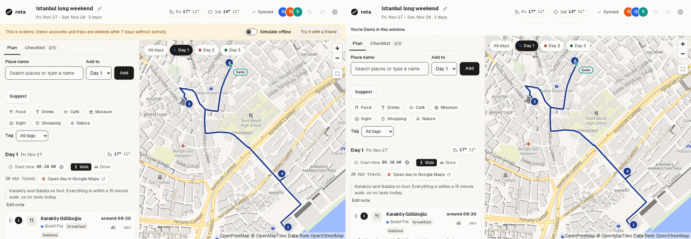
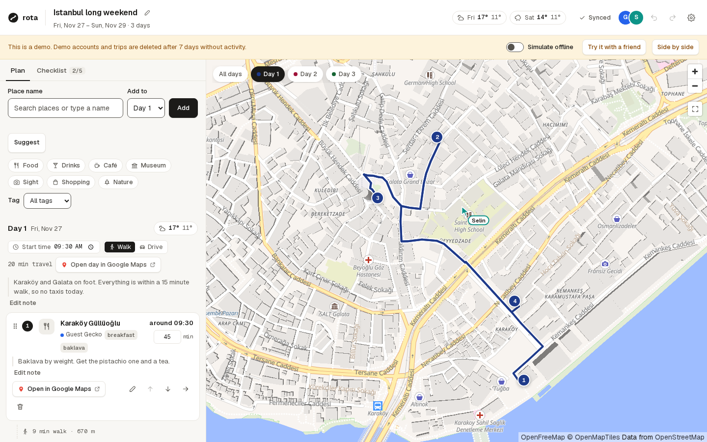
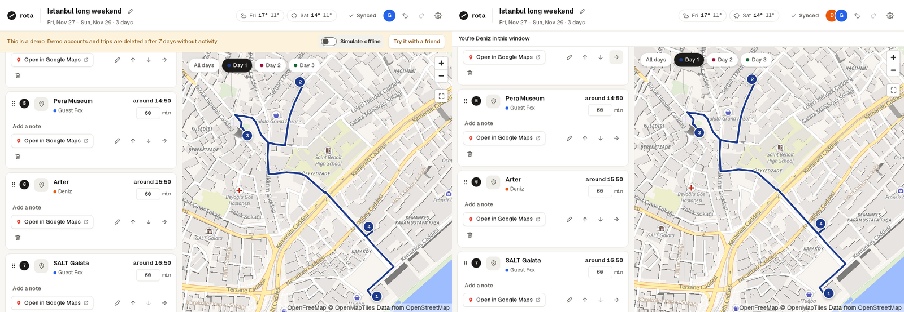
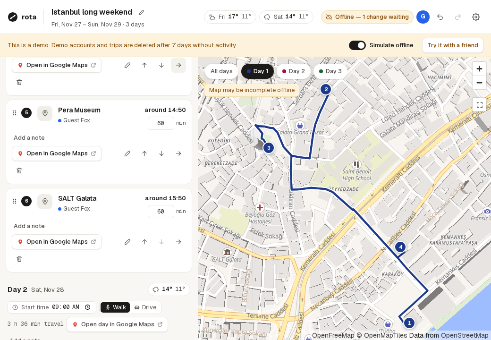
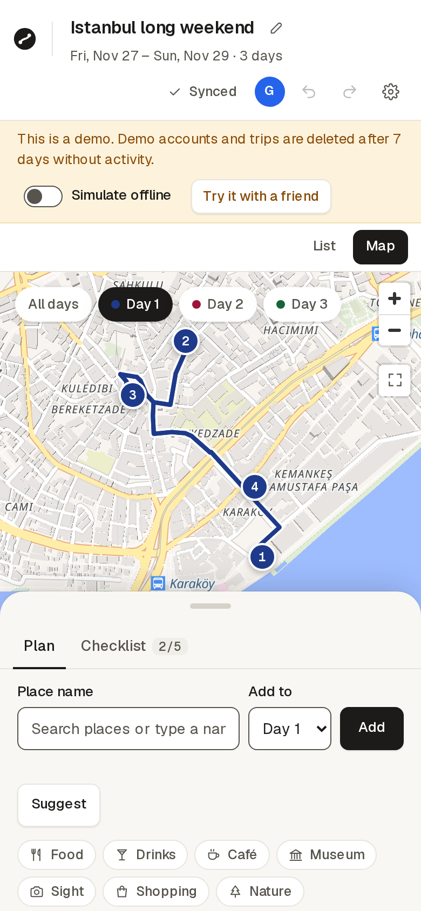
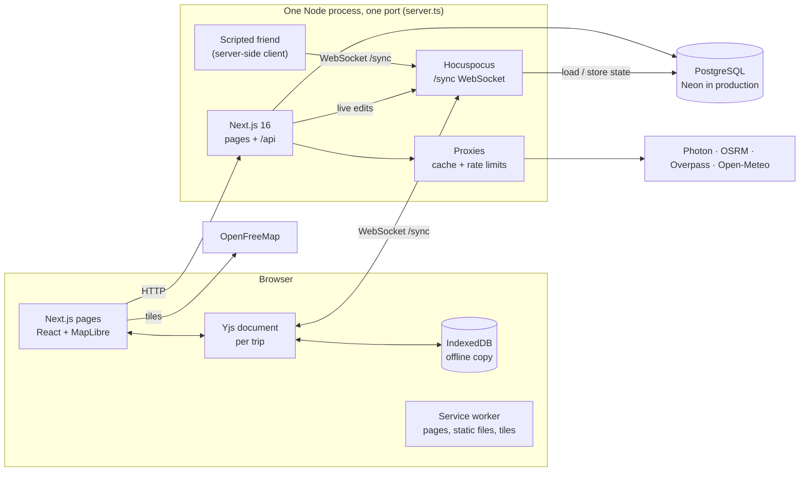

# Tripify: plan a trip together, live and offline

A group trip planner. Everyone in a trip adds places from the map, sorts them into days and sees the same plan update live, on a good connection, a bad one or none at all. Edits made offline merge when the device reconnects, and **two people moving the same place at the same moment never end up with two copies of it or none**.

[](https://github.com/cemakcck/rota/actions/workflows/ci.yml)
[](LICENSE)

**Live demo:** launching soon · **Portfolio:** [cemakcicek.com](https://cemakcicek.com) · **GitHub:** [@cemakcck](https://github.com/cemakcck)

Next.js 16 · TypeScript · Yjs + Hocuspocus · MapLibre GL · PostgreSQL 17 · Drizzle ORM · Better Auth · next-intl (English/Turkish) · Vitest · Playwright



| Trip: list, map and route | Two people, one trip |
| --- | --- |
|  |  |
| **Offline, one change waiting** | **Phone layout** |
|  |  |

The screenshots come from [`apps/web/scripts/screenshots.ts`](apps/web/scripts/screenshots.ts), a Playwright script run against the dev server with real OpenFreeMap tiles and the real routing, weather and opening-hours services behind the app's proxies (`STUB=1` stubs them the way the end-to-end suite does).

## Try this

1. **Try the demo.** One click creates a private demo account and a lived-in trip, "Istanbul long weekend": three days, twelve places across Karaköy, Balat, Kadıköy and the Bosphorus, a checklist and two suggestions with votes. About ten seconds in, **Selin** drops by: her cursor crosses the map, she adds to a note, votes and ticks a checklist item, then leaves.
2. **Try it with a friend.** The banner opens the same trip in a second window signed in as **Deniz** (on wide screens, "Side by side" puts it next to yours). Add or move a place in one window and watch the other.
3. **Simulate offline** in your window. The header switches to "Offline — no changes waiting".
4. **Edit both.** Add a place to Day 1 in your window and another in Deniz's. Yours counts up ("Offline — 1 change waiting") and does not see Deniz's.
5. **Switch back.** Turn "Simulate offline" off: the header goes "Syncing…" then "Synced", and both windows show both places in the same order.

The demo needs no sign-up and no second person. Demo accounts and their trips are deleted after 7 days without activity; real accounts never are.

## What it does

- **Trips and people.** Email and password accounts with a display name and colour. Create a trip (name, start date, 1 to 30 days, optional destination), invite people by link (with a QR code) or by email (people without an account join through the single-use link in that email). Every member edits; the owner manages members and invites, hands over ownership and deletes the trip. A removed member, or everyone when a trip is deleted, is told so on their device, including about any offline edits that can no longer sync.
- **Places.** Add them by searching (Photon, OpenStreetMap data, biased to the map's view), by right-clicking or long-pressing the map, or by name only. Each has one of eleven categories (food, drinks, café, museum, sight, nightlife, shopping, nature, gym, stay, other), up to five tags, a collaborative note, a stay duration and votes. Filter the list and map by category and tag. **Suggestions** collect up and down votes until someone accepts or dismisses them.
- **Days, order and routes.** Each day holds places in order. Drag to reorder or move between days and Ideas, or use the keyboard and "Move to…". The map numbers each day's pins in the day's colour and draws the route along roads; the list shows "12 min walk" between stops, a day total, and arrival estimates from the day's start time ("around 11:20"). Each day walks or drives.
- **Google Maps.** Every place opens in Google Maps; every day opens as a Google Maps route with its stops in order, split into parts beyond nine waypoints.
- **Weather and opening hours.** A forecast per day at the destination (Open-Meteo), and warnings from OpenStreetMap's opening hours when you would arrive at a closed place ("Opens at 10:00 — you arrive around 09:30"). No data means no warning, never a guess.
- **Shared checklist** for packing and tickets, with assignees.
- **Live together.** Avatars of who is in the trip now, the place someone is editing outlined in their colour, their caret in notes, their cursor on the map. Undo and redo are per person: your undo never reverts a friend's edit. Screen readers hear remote changes ("Deniz moved Galata Tower to Day 2").
- **Offline.** An installable PWA. Every trip opened on a device is kept in IndexedDB and opens without a connection; the header says "Synced", "Syncing…" or "Offline — N changes waiting". Map tiles seen online are cached. Search, routing (falls back to "≈" straight-line estimates), weather and opening hours need a connection.
- **English and Turkish**, desktop and phone layouts, WCAG 2.2 AA.

## Mobile app — coming in phase 2

An iOS and Android app built with Expo (React Native) is next. It shares [`packages/trip`](packages/trip) (the document model, ordering, timeline, travel estimates, Google Maps links and opening-hours evaluation) with the web app and syncs through the same `/sync` endpoint, so an edit on the phone shows on the laptop at once and the other way round. It will be distributed as an Android APK and shown on iOS through a simulator recording. This section will cover it when it lands.

## Engineering decisions

- **A CRDT, not a server that decides.** Each trip is one [Yjs](https://yjs.dev) document: places, days, checklist, notes and settings. Every device applies edits locally and exchanges updates; Yjs merges them the same way everywhere, so two people editing at once, or one coming back after a day offline, converge without a conflict dialog. The server relays and stores updates; it never has to arbitrate.
- **Moves are one field, not an array splice.** A place's position is `dayId` plus a fractional-index `order` key on the place itself ([`packages/trip/src/order.ts`](packages/trip/src/order.ts)). A move rewrites those two fields, each last-writer-wins, so concurrent moves of the same place pick one winner and can never duplicate or drop it. The test suite keeps a proof of the alternative: the naive "delete from one `Y.Array`, insert into another" duplicates the place under concurrent moves. Concurrent appends can produce equal keys, and no key fits strictly between two equal ones, so a drop into a tied group also rekeys the tied items after it in the same transaction; order then breaks ties by id, identically on every device.
- **Offline queue you can see.** Edits go to IndexedDB first and to the server when it is reachable; the provider attaches only after the local copy has loaded, so the first sync carries everything offline in one go. "N changes waiting" counts records (a place, a day, a checklist item, the trip settings), not keystrokes, and clears only on the server's acknowledgement. The count is per user and per tab in `localStorage`, unioned across that user's tabs. The user's tabs relay their edits to each other over a `BroadcastChannel`, and a tab that crashed, froze or closed with work waiting is adopted by a live one, which re-reads IndexedDB and takes over its records ([`apps/web/src/client/sync/pending.ts`](apps/web/src/client/sync/pending.ts)).
- **Sync checks membership, including during connect.** The WebSocket authenticates with the session cookie or a bearer token, and `trip_members` decides. Removal and deletion close live connections at once. Loading a document can take seconds on a cold database, and a removal committed in that window could not find the connection to close it yet, so access is checked again after the connection joins the document and every message it sends waits for that check ([`apps/web/src/server/sync.ts`](apps/web/src/server/sync.ts)). Refusals say why (`removed`, `deleted`, `not-found`, `full`), and the device tells its user.
- **Limits never eat offline work.** The server never refuses a member's update for size. The soft caps (2 MB per document, 200 places, 100 checklist items) are enforced in the interface ("This trip is full"). The hard WebSocket cap is 8 MB per message, four times the soft cap, because a long offline session goes up as one message on reconnect: a lower cap would close the socket on every reconnect and that work would never sync. An update that would add data outside the trip schema closes only the connection that sent it.
- **One process, one port.** [`apps/web/server.ts`](apps/web/server.ts) runs Next.js and Hocuspocus on the same HTTP server; `/sync` is the WebSocket. One origin means no CORS, cookies just work, and Railway sees a single service. Getting there took one fix worth knowing: on the first request it serves, Next adds its own `upgrade` listener to the server, which runs its router on every upgrade and ends sockets whose path matches a page. `/sync` matches `/[locale]`, so Next was killing sync sockets just after they were accepted. Next now gets a server of its own that never listens, and only non-`/sync` upgrades (HMR in dev) are passed to it.
- **One Yjs per process.** Route handlers edit live documents (renaming a trip, mirroring members) through the running sync server, and Yjs types from one copy of the library break the checks of another. `serverExternalPackages: ["yjs"]` keeps Next from bundling a second copy into the route handlers, the running server is shared through `globalThis` because Next bundles route handlers separately from `server.ts`, and a production-build integration test fails if a second Yjs ever loads.
- **Free services behind rate-limited proxies, with a fallback.** Search (Photon), routing (FOSSGIS OSRM), opening hours (Overpass) and weather (Open-Meteo) go through the app's own endpoints: cached, at most one upstream request per second per service with a descriptive User-Agent, identical in-flight requests shared, and per-IP limits (search 60/min, routing 120/min, hours and weather 60/min). When a service is slow, busy or down, routing falls back to straight-line estimates marked "≈" and the rest simply hides. Map tiles load directly from OpenFreeMap.
- **Neon cold starts are retried, not shown.** Neon's free Postgres sleeps when idle and drops the first connections when it wakes. Every query, including transactions and migrations, goes through `withDbRetry`, which retries connection-class errors only (`ECONNRESET`, `57P01`, …) with exponential backoff. The health check (`/api/health`) never touches the database, so a sleeping database never fails a deploy.
- **Client IPs from the trusted end.** Rate limits key on an HMAC of the client IP (raw IPs are never stored). `X-Forwarded-For` entries a client sends are spoofable, so the IP is taken `TRUSTED_PROXY_HOPS` (default 1) entries from the end, the one Railway's edge adds. Railway's docs name `X-Real-IP` as the client header and a Railway staff answer says the edge overwrites `X-Forwarded-For`; other users report that it appends. The last entry is the client in both cases.
- **The scripted friend uses the real sync path.** Selin is a server-side Hocuspocus client that connects to the server's own `/sync` with a real session, like any browser. Her visit exercises authentication, membership, presence and persistence end to end, and the end-to-end suite watches her arrive. Deniz's "friend window" uses a bearer token kept in that window's `sessionStorage`, so one browser can be two people.
- **Service-worker caches per build.** `/sw.js` is served by a route that fills in the build id, so each build names its own caches for pages and static files and its worker deletes the previous build's when it activates; old chunks never pile up and a new deploy never serves a page that points at missing chunks. Map tiles survive builds (they don't change with the app), capped at 2000.

## Architecture



- **Next.js 16 (App Router)** renders pages and serves the JSON API under `/api`: trips, members, invites, profile, demo, and the proxies. Auth is Better Auth (cookies for the web, bearer tokens for friend windows and later the mobile app).
- **Hocuspocus** holds the live Yjs documents, checks membership, and stores each document's state in `trip_documents` (debounced, merging with server-side edits made in between).
- **[`packages/trip`](packages/trip)** is the trip model shared by web and (in phase 2) mobile: document schema and edits, ordering, the read model, timeline, travel estimates, Google Maps links, opening-hours evaluation and per-person undo. No DOM or React imports.

Sync, offline and the failure cases are covered in more depth in [docs/ARCHITECTURE.md](docs/ARCHITECTURE.md).

## Running locally

You need **Node.js 22+** and **Docker** (with Compose). No cloud account or API key is needed.

```bash
git clone https://github.com/cemakcck/rota.git && cd rota
npm install
npm run db:up                           # Postgres 17 in Docker on localhost:5434
cp apps/web/.env.example apps/web/.env.local   # the defaults work as-is for local use
npm run db:migrate
npm run dev                             # http://localhost:3400
```

Open http://localhost:3400 and click **Try the demo**.

- **Port 5434 already taken?** Start the database with `ROTA_DB_PORT=5435 npm run db:up` and change `5434` in `.env.local` (and in `TEST_DATABASE_URL` for the tests).
- **Email** (invites, password reset) is logged to the terminal running `npm run dev` unless you set `RESEND_API_KEY` and `EMAIL_FROM`.
- `npm run build && npm start` runs the production build behind the same server.

### Environment variables

| Variable | Required | What it does |
| --- | --- | --- |
| `DATABASE_URL` | yes | Postgres connection string |
| `BETTER_AUTH_SECRET` | yes | Signs sessions. The `.env.example` value is for local use only |
| `BETTER_AUTH_URL` | yes | The app's public URL: auth callbacks and links in emails |
| `IP_HASH_SECRET` | in production | HMAC key for visitor IPs (rate limits). Raw IPs are never stored |
| `PORT` | no | The one port for pages, API and `/sync` (3400 locally; Railway sets it) |
| `TRUSTED_PROXY_HOPS` | no | Proxies that append to `X-Forwarded-For`; the client IP is that many entries from the end. Default 1 (Railway); 0 ignores the header |
| `RESEND_API_KEY`, `EMAIL_FROM` | in production | Send real email through Resend. Without a key, every email (invites and password-reset links included) is only written to the server log, so nobody receives it |
| `FRIEND_DELAY_MS` | no | How long the scripted friend waits before joining a new demo trip (default 10000) |
| `TEST_DATABASE_URL` | for tests | Base URL for the test databases (`rota_test`, `rota_e2e`), created on the same server |

## Tests

```bash
npm run lint && npm run typecheck
npm test                          # unit + integration (needs the database from npm run db:up)
npx playwright install chromium   # once, for the end-to-end tests
npm run test:e2e                  # builds for production and serves it on :3401
```

- **Shared package (`packages/trip`):** the merge tests (the naive array move duplicating a place; concurrent moves leaving one copy; move against delete; tied inserts; concurrent note edits; a 50-edit offline document merging with one that changed meanwhile; checklist ticks), ordering and tie rekeying, timeline arithmetic, opening-hours evaluation, Google Maps links with the 9-waypoint split, per-person undo and the demo seed.
- **Unit (web):** the pending-changes count across tabs, sync status, presence, the service worker, components (itinerary, map, bottom sheet, suggestions, checklist, notes, invites), IP handling, and EN/TR message-key parity.
- **Integration, against a real Postgres and a running server:** auth and sign-up limits, membership on the API and on `/sync` (non-members refused, removed members disconnected, including during connect), invites by link and by email, persistence across restarts, live server-side edits, the scripted friend, proxies with mocked upstreams and their limits, cleanup, cold-start retry, and the same live checks against a production build (one Yjs, the service worker naming its build, MapLibre's worker).
- **End-to-end (Playwright, production build):** two people editing one trip and seeing each other within 2 seconds, offline convergence with both `setOffline` and the Simulate offline switch, trips opening offline after one visit, the demo with Deniz and Selin, invites, and axe scans of every page in both languages (zero serious or critical violations).

All tests run with `TZ=America/New_York`, so the trip's local wall-clock times can't lean on the machine's time zone.

**CI:** GitHub Actions ([`.github/workflows/ci.yml`](.github/workflows/ci.yml)) runs lint and typecheck, builds for production once, then runs the unit, integration and end-to-end tests against that build (`ROTA_REUSE_BUILD=1`), with Postgres 17 as a service container.

**Container smoke:** `docker build -t rota . && scripts/docker-smoke.sh` runs the image against the local database on port 3402 and checks the health check, a page, the service worker (carrying the image's build id), MapLibre's worker, that migrations ran, and a demo start.

## Deploying (Railway + Neon)

The app is one Docker container ([`Dockerfile`](Dockerfile), [`railway.json`](railway.json)) and a Postgres database. The image builds the app and bundles the server; at start it runs the migrations (retrying while Neon wakes up), then the server.

1. **Database.** Create a free project on [Neon](https://neon.tech) and copy the **direct** (not pooled) connection string, with `sslmode=require`. The pooled endpoint runs PgBouncer in transaction mode, which does not suit postgres.js's prepared statements.
2. **Service.** On [Railway](https://railway.com), create a project from the GitHub repo. Railway finds `railway.json`, builds the Dockerfile, and health-checks `/api/health`. Keep one replica: live documents are held in the process.
3. **Variables.** Set `DATABASE_URL` (from Neon), `BETTER_AUTH_SECRET` and `IP_HASH_SECRET` (each `openssl rand -base64 32`), `BETTER_AUTH_URL` (the public URL, e.g. `https://rota.example.com`), and `RESEND_API_KEY` and `EMAIL_FROM` (without a key, invite and password-reset emails only go to the server log). Railway sets `PORT`; `TRUSTED_PROXY_HOPS` defaults to 1, right for Railway's edge.
4. **Domain.** Generate a Railway domain or add a custom one under the service's networking settings, and make sure `BETTER_AUTH_URL` matches it. WebSockets (`/sync`) need no extra setup.
5. **Check.** Open the site, click "Try the demo", and confirm Selin shows up after about ten seconds: she connects through the deployed `/sync`, so that proves the WebSocket path through Railway's proxy.

## Project structure

```
apps/web/
  server.ts               the one-port server: Next.js + Hocuspocus at /sync
  src/app/                pages ([locale]/…), the JSON API (api/…), /sw.js and MapLibre's worker
  src/components/         trip screen, map, itinerary, demo banner, auth, landing
  src/client/             sync (useTrip, pending changes, status), presence, auth client
  src/server/             auth, sync server, trips and invites, demo and scripted friend, proxies, db
  src/sw/sw.js            the service worker (served with the build id filled in)
  scripts/                migrate, bundle (for the container), screenshots
  drizzle/                SQL migrations
  messages/               en.json and tr.json
  tests/unit, tests/integration, tests/e2e
packages/trip/            the shared trip model (web now, mobile in phase 2)
scripts/docker-smoke.sh   smoke test of the production image
docs/                     architecture notes, screenshots, design spec
```

## Known limits

- Not deployed yet; the Railway + Neon setup above is prepared and smoke-tested locally in Docker.
- One server process: live documents live in memory, so the service runs as a single replica.
- Light theme only. No Google sign-in yet. The mobile app is phase 2.
- Search, routing, weather and opening hours rely on free public services; when they are down, the app falls back as described above.

## Credits

Map data © [OpenStreetMap contributors](https://www.openstreetmap.org/copyright). Map tiles and style by [OpenFreeMap](https://openfreemap.org) (OpenMapTiles schema). Search and reverse geocoding by [Photon](https://photon.komoot.io) from [komoot](https://www.komoot.com). Routing by the [FOSSGIS OSRM servers](https://routing.openstreetmap.de). Opening hours from the [Overpass API](https://overpass-api.de). Weather by [Open-Meteo](https://open-meteo.com).

## License

[MIT](LICENSE) © Cem Akçiçek
